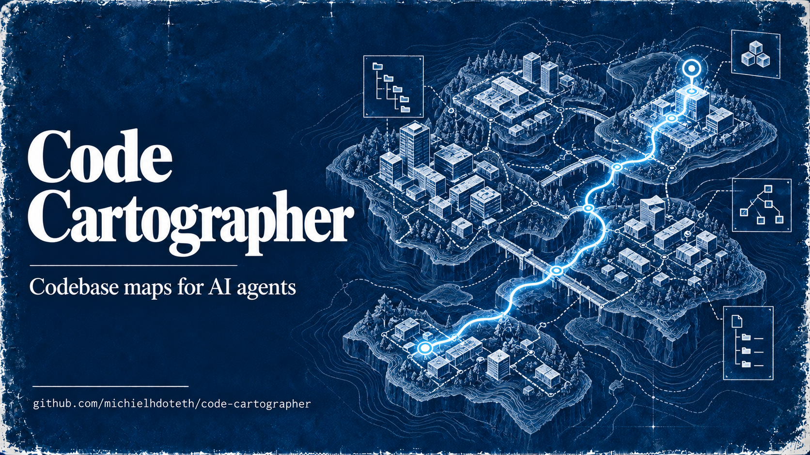

# Code Cartographer

<p align="center">
  
</p>

Code Cartographer maps a codebase so developers and AI agents can find relevant code without reading the whole repository. Its Go CLI parses 22 languages, searches symbols and source, traces dependency impact, compares commits, and builds token-budgeted context. The web UI visualizes repository structure and dependencies.

## Quick start

### Build the CLI

Requires Go 1.25 or newer.

```bash
mkdir -p bin
cd cmd
go build -o ../bin/carto .
cd ..
```

On Windows, use PowerShell:

```powershell
New-Item -ItemType Directory -Force .\bin | Out-Null
Push-Location .\cmd
go build -o ..\bin\carto.exe .
Pop-Location
```

Map and inspect a project:

```bash
./bin/carto map ./my-project
./bin/carto stats ./my-project
./bin/carto analyze all ./my-project
./bin/carto find "functionName" ./my-project
```

The map records the Git commit, branch, and timestamp. Cartographer stores local manifests and indexes under `.carto/` in the target project.

### Build and run the Web UI

Requires Bun.

```bash
bun install
bun run build
./bin/carto serve
```

The `serve` command serves the generated `./build` directory from the current working directory.

## CLI commands

| Command | What it does |
| --- | --- |
| `carto map <path>` | Scan a codebase and record its Git revision |
| `carto analyze [type] [path]` | Analyze dead code, complexity, circular dependencies, structure, or health |
| `carto find <pattern> [path]` | Search source files for text or a regular expression |
| `carto search <query> [path]` | Ranked full-text search over `.carto/search-index.json` (BM25F) |
| `carto symbols <path>` | List functions, classes, types, and other symbols |
| `carto stats [path]` | Summarize files, imports, symbols, and languages |
| `carto brief [path]` | Compact token-budgeted repo orientation (L0) |
| `carto context <file>` | Full file context, or `--outline`/`--symbols`/`--lines` AST views |
| `carto chunk <file>` | List or fetch ~300-token AST-aligned chunks of a large file |
| `carto fix <finding-id> [path]` | Generate an LLM-ready refactor prompt for a structural finding |
| `carto index [path]` | Build a local full-text index at `.carto/search-index.json` |
| `carto diff [path]` | Show changes since the last map |
| `carto changed [path]` | List uncommitted additions, edits, and deletions |
| `carto impact <file>` | Trace the dependency blast radius of a file |
| `carto ask <question> [path]` | Rank relevant symbols and return source snippets |
| `carto trace <symbol> [path]` | Show callers and callees with match confidence |
| `carto outline <file> [path]` | List a file's symbols and source ranges |
| `carto check [path]` | Check whether the local graph cache is fresh |
| `carto repo-map [path]` | Generate a ranked, token-budgeted signature map for an agent |
| `carto pack [path]` | Build filtered or compressed repository context within a token budget |
| `carto skill` | Print the CLI skill; `--install` writes it and `AGENTS.md` |
| `carto doctor [path]` | Check graph freshness, parser coverage, config, and CLI guidance |
| `carto schema [command]` | Print a command's versioned JSON output contract |
| `carto init [path]` | Create `.carto/config.json` and install CLI guidance |
| `carto info` | Show CLI information and examples |
| `carto serve` | Start the interactive Web UI |

Examples:

```bash
carto map ./my-project --lang go,typescript
carto analyze dead-code ./my-project --json
carto analyze structure ./my-project --json --fail-on critical
carto fix arch/shallow-module:9f3a1c2d4e ./my-project --tokens 4000
carto symbols ./my-project --type function
carto brief ./my-project --tokens 1200 --json
carto context ./my-project/src/main.go --outline --tokens 512 --json
carto chunk ./my-project/src/main.go --list --json
carto chunk ./my-project/src/main.go --chunk 0 --json
carto context ./my-project/src/main.go --tokens 8000 --imports --callers --cohesion --json
carto index ./my-project
carto diff ./my-project
carto changed ./my-project
carto ask "where is authentication validated" ./my-project --json
carto ask "ValidateToken" ./my-project --answer-only --json
carto repo-map ./my-project --expand --json
carto pack ./my-project --jsonl
carto impact ./my-project/src/handler.go --json
carto search "token validation" ./my-project --json
carto trace ValidateToken ./my-project --json
carto outline ./my-project/internal/auth/token.go
carto check ./my-project --json
carto repo-map ./my-project --tokens 2048 --focus src/auth
carto pack ./my-project --include 'src/**' --exclude '**/*_test.go' --compress --tokens 8000
carto trace ValidateToken ./my-project --depth 3 --direction callers
carto impact ValidateToken --symbol --depth 3
carto doctor . --json
carto schema context
carto skill --install
carto init .
```

`carto impact <file>` resolves the file from the current working directory. Run it from the root of the project you want to inspect:

```bash
cd ./my-project
carto impact cmd/main.go
```

Use `carto --help` or `carto <command> --help` to see all options. The global `--json` flag returns machine-readable output where supported.

## Code analysis

Code Cartographer supports 22 languages through Tree-sitter parsers and built-in fallback parsing. It extracts declarations, imports, and function calls to build code relationships and metrics.

| Analysis | What it looks for |
| --- | --- |
| Dead code | Unused exports and orphaned files, with confidence and repository-history signals |
| Duplicate blocks | Repeated normalized function bodies across files |
| Complexity | Functions with high cyclomatic complexity |
| Circular dependencies | Import cycles between files or modules |
| Health | A combined view of detected issues and code metrics |
| Blast radius | Direct and transitive dependents, hubs, and concentrated file risk |

### Structural health (deep modules, narrow interfaces)

`carto analyze structure` turns the dependency graph into a prioritized structural report. It groups files into modules (package directories, with sparse nested directories collapsed upward), measures exported surface against internal implementation, and emits stable finding IDs:

| Rule | Severity | Meaning |
| --- | --- | --- |
| `arch/module-cycle` | 🔴 critical | Two or more peer modules depend on each other |
| `arch/tangle` | 🟡 warning | A parent and its child module reference each other (wrong layering) |
| `arch/shallow-module` | 🟡 warning | Callers use most exports while the module holds little implementation |
| `arch/broad-interface` | ℹ info | Most exports are used by at most one module (speculative surface) |
| `arch/scattered-feature` | 🟡 warning | One symbol's callers span several top-level areas, inflating repo context |

```bash
carto analyze structure ./my-project --json
carto analyze structure ./my-project --fail-on critical   # non-zero exit on critical findings
carto analyze health ./my-project --include-structure    # fold findings into the health score
```

Findings can be suppressed with a reason-carrying allowlist at `.carto/structure-allow` (or `--allow <path>`). One entry per line: either a full finding ID or `rule|module`. Comments start with `#`:

```
# arch/module-cycle:api+worker: accepted until the shared contract is extracted
arch/module-cycle|api + worker
```

`carto fix <finding-id>` builds an LLM-ready prompt from the finding and its call sites from the local graph. It makes no model calls and changes no files; the prompt asks an agent to inventory, redesign from first principles, fix, and re-run `carto analyze structure` to verify.

Inspiration: deslop-please (MIT) and the `untangle-codebase` refactor workflow. The rules here are independent implementations adapted to carto's multi-language file graph.

## Context and search

`carto context` gathers a target file and can add its imports or callers. It reports estimated token usage, truncation status, and estimated savings versus a whole-repository dump, so an agent can request relevant surrounding code with a chosen budget. With `--cohesion` it also reports how scattered the related context is across top-level directories:

```bash
carto context ./src/handler.go --tokens 8000 --imports --callers --cohesion --json
```

Savings and cohesion are deterministic heuristics based on the local graph and a provider-neutral ~4 bytes/token estimate; they are not model tokenizer counts.

`carto ask` ranks declarations with deterministic BM25F over AST-derived fields (name, qualified name, signature, doc comment, path, kind, body), fused with exact-symbol, fuzzy-identifier, and name-overlap routes plus a capped graph-centrality tie-break. `--answer-only` returns graph facts (name, file, callers, callees) without source bodies. Go import edges in Go repositories are resolved through the local `go list` toolchain instead of suffix guessing. Graph nodes and edges carry `flags` (test/generated) and `role` (extracted/inferred). `carto search` applies the same BM25F scorer to the full-text index built by `carto index`. Tokenized documents are cached at `.carto/retrieval.json`, keyed by the existing graph file hashes, so a stale graph rebuilds them automatically.

`carto repo-map` ranks declarations by resolved graph connectivity and exports compact signatures without bodies; use repeatable `--focus` paths to raise a working area. Both commands accept an estimated token budget and emit JSON with `--json`.

`carto pack` emits selected source files, or declarations and imports with `--compress`, using repeatable `--include` and `--exclude` path globs. It writes context to stdout unless `--output` names a file. Token counts use a provider-neutral estimate of about four UTF-8 bytes per token, not an exact model tokenizer.

`carto trace` follows parsed calls with bounded `--depth` and `--direction callers|callees|both`; `carto impact <symbol> --symbol` reports caller impact. Inferred edges retain confidence labels. These commands are local and deterministic, and expose JSON with `--json` for any agent that can invoke a CLI.

`carto map` also writes a versioned symbol graph to `.carto/graph.json`. Repeated builds reuse unchanged file parses by content hash. Run `carto check` to see added, changed, or deleted source files without rebuilding the cache.

`carto symbols` lists declarations by file or directory. `carto find` searches source text, with optional regular-expression and case-sensitive modes. `carto index` builds a reusable local term index for source files.

## Using carto from an AI agent

carto is built to be a tool for AI agents. The agent is the LLM — it reasons, decides what to look at, and calls carto through a shell or tool interface. carto itself has no model inside and never makes an LLM or network call; it only maps code and returns small, structured answers so the agent's context window stays useful. Humans can use the same commands directly.

Run `carto skill` to print the CLI skill (trigger phrases, command cookbook, workflow, and gotchas), or `carto skill --install` to write it to `.claude/skills/carto/SKILL.md` and add a guide to `AGENTS.md`. `carto skill --check` detects drift in CI. `carto init` also creates `.carto/config.json` with default token budgets and structure thresholds; command flags always override the config.

For large files, use progressive disclosure instead of reading the whole file: `carto brief` (L0) → `carto context <file> --outline` (L1, signatures and line ranges only) → `carto chunk <file> --list` / `--chunk N` (L2, ~300-token AST-aligned pieces) → full `carto context` only when necessary. Every view includes `savings.avoided_lines`, `savings.avoided_tokens`, and a `context_efficiency_score`, plus a `suggested_next` command.

Recommended workflow:

```bash
carto doctor . --json                        # 1. is the graph trustworthy?
carto repo-map . --tokens 2048 --json        # 2. orient cheaply
carto ask "where is X" . --json              # 3. locate symbols
carto context ./path/to/file --imports --callers --cohesion --json
carto analyze structure . --json             # 4. check architecture before editing
carto fix <finding-id> --tokens 4000         # 5. get a refactor prompt, no model calls
carto analyze structure . --json             # 6. verify the finding disappeared
```

## Output and exit codes

`carto schema <command>` prints the JSON fields for a command. The global `--json` flag writes JSON to stdout with no progress lines. Token counts use a provider-neutral estimate of about four UTF-8 bytes per token; savings objects state their basis.

Exit codes: `0` success, `1` findings reached a threshold, `2` usage error, `3` stale graph (run `carto map`), `4` I/O or config error. `carto check` returns `3` for a stale graph.

On the 100-case suite: ask uses ~1589 tokens/case, the consult path (L0 brief → L1 skeleton → L2 chunk) uses ~711, versus ~3104 to read the target files whole — about 4.4× fewer tokens at 0.95 recall. On the 30 hand-labelled cases alone: ~670 vs ~2729 tokens (4.1× fewer) at 0.79 recall. Both runs were deterministic. These are local retrieval measurements, not end-task success.

## Commit-aware repository context

Cartographer associates a map with the Git revision where it was created. Use `diff` to see committed changes since that map and `changed` to inspect the current working tree. Use `impact` to follow dependencies before changing a file.

This helps answer questions such as “what changed?”, “where is this symbol defined?”, and “which files may be affected by this edit?”

## Interactive Web UI

The Web UI helps people explore repository structure with a file explorer, language distribution, health and architecture panels, Git diff views, dependency hubs, and graph layouts including tree, treemap, matrix, radial, and flow.

## Technology

- **CLI:** Go, Cobra, and Tree-sitter
- **Web UI:** React, TypeScript, Vite, Tailwind CSS, D3.js, and WebGL
- **Package manager:** Bun

## Development

Build and test the Go CLI:

```bash
cd cmd
go test ./...
go build ./...
```

Run the Web UI checks and build:

```bash
bun install
bun run test
bun run type-check
bun run build
```

## License

MIT
